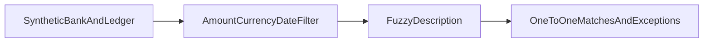

1. Match bank transactions to ledger entries with fuzzy rules, explain each match, surface exceptions.

2. Result:
   Synthetic bank transactions: 200  
   Match rate: 0.83  
   False-match rate: 0.0  

   Measured with `make bench`: [raw results](evidence/bench.json), [command output](evidence/checks.log), [environment](evidence/environment.json).

3. Architecture:


4. Run it:
```sh
make setup
make lint test bench
make demo
```

5. Decisions and limits: Synthetic financial data only. Integer cents avoid rounding ambiguity; currency and amount must match exactly before fuzzy description/date comparison. Ambiguous candidates are surfaced rather than forced. Injected amount changes and missing entries reduce match rate intentionally. False-match rate uses the generated pairing labels; it is not a production estimate. Every accepted match has a score and explanation in evidence/reconciliation.json. Processing order can affect conflicts; global optimal assignment remains Next.

6. Next: Add global assignment, partial payments and separately calibrated candidate scoring.
